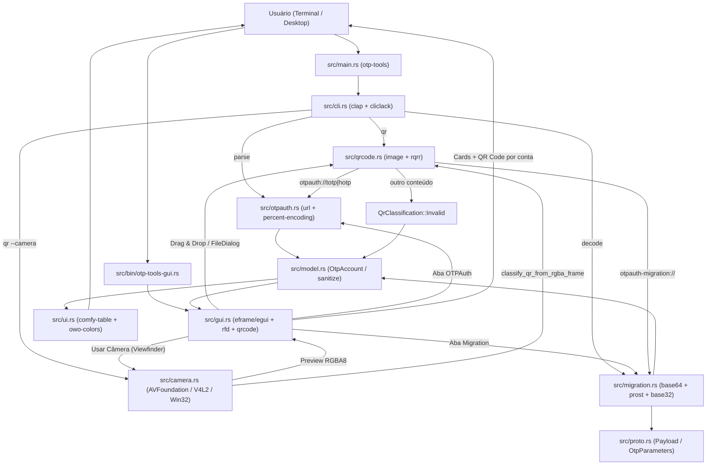

# Organograma

## Arquitetura de módulos e fluxo de processamento — OTP Tools (CLI + GUI)

## Histórico

- `2026-11-19`: Criação inicial do organograma de módulos e fluxo de dados.
- `2026-11-19`: Atualização do diagrama incluindo o binário GUI (`otpauth-migration-gui`) e o módulo `src/gui.rs`.
- `2026-11-19`: Atualização dos nomes para **OTP Tools** (`otp-tools`, `otp-tools-gui`) e saída com geração de QR Code por conta na GUI.
- `2026-11-19`: Inclusão de `src/camera.rs` conectado ao fluxo da GUI, CLI e `src/qrcode.rs`.
